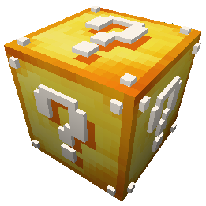
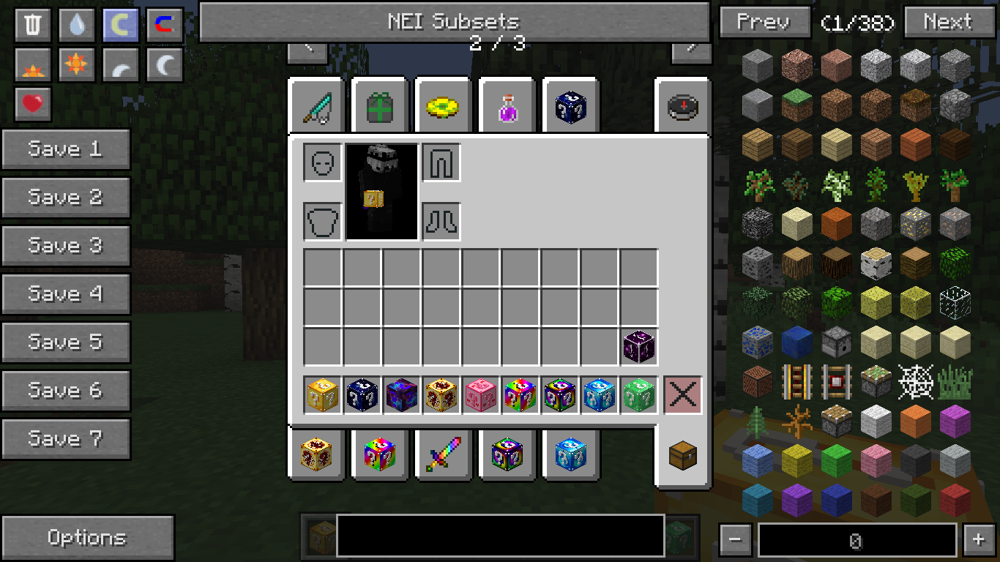
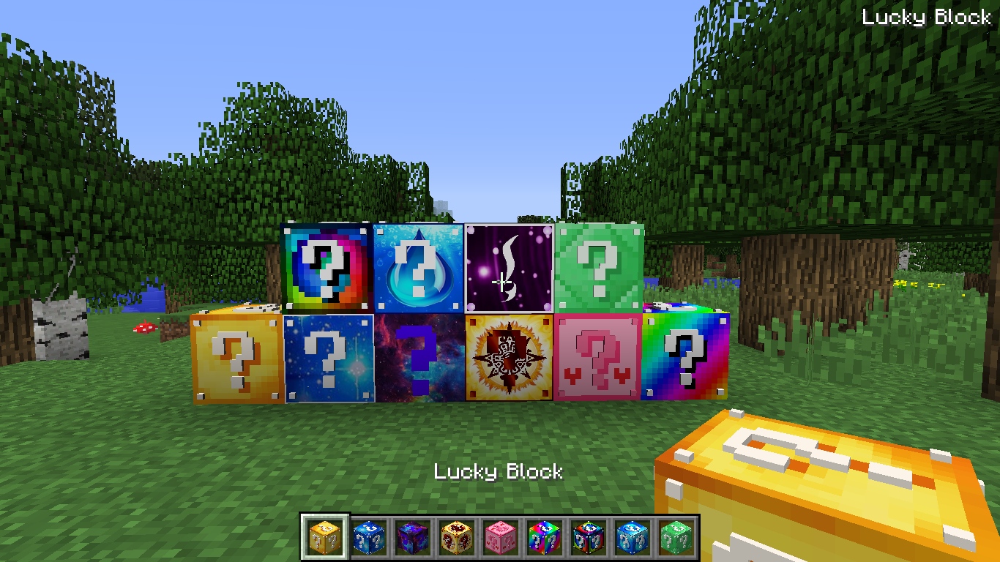

# Minecraft Lucky Blocks

Um pacote de mods e addons de Lucky Block para **Minecraft 1.8**. A ideia é reunir o mod principal, seus mods de apoio e diferentes Lucky Blocks para testar em um mundo.

> Dica: baixe sempre a última versão do Minecraft Forge ou de qualquer versão do minecraft que escolher. Neste ambiente, demonstramos apenas a última versão do Forge 1.8.

  

## O que vem no pacote

- `1.8/mods/`: mods e dependências para a instalação Forge 1.8.
- `1.8/lucky-blocks/`: addons com diferentes temas e efeitos de Lucky Block.
- `_assets/`: imagens usadas neste README.

### Mods incluídos

- **Lucky Block**: adiciona o bloco que pode gerar itens, criaturas e eventos aleatórios.
- **Loot++**: amplia as possibilidades de loot usadas pelo mod.
- **CodeChickenCore** e **NotEnoughItems (NEI)**: bibliotecas e ferramentas de interface usadas por mods do pacote.
- **OptiFine**: opções gráficas e de desempenho.
- **ArmorPlus**, **Just a Few Fish**, **More Player Models**, **Mouse Tweaks**, **PotionCore**, **Trades** e **EasyLAN**: manipulação de itens, modelos, mobs, spawns e interações do mundo.

Os arquivos e versões específicos estão em `1.8/mods/`. Não remova as bibliotecas que outros mods possam exigir.

### Lucky Blocks adicionais

A pasta `1.8/lucky-blocks/` contém addons como Emerald, Fantos, Water, Spiral, Rainbow, Pink, Night, Inca, Galaxy e Astral. Eles são arquivos `.zip` e `.jar`; mantenha-os como estão e siga as instruções do addon e do mod Lucky Block para instalá-los. A compatibilidade pode variar entre addons — confira a versão indicada no nome ou na página de origem antes de usar.

Screenshots

## Instalação

1. Faça uma cópia de segurança da pasta `mods` do seu perfil atual.
2. Instale **Minecraft Forge para Minecraft 1.8** e abra esse perfil pelo menos uma vez.
3. Copie os arquivos de `1.8/mods/` para a pasta `mods` desse perfil. Se possível, use um perfil separado para este pacote.
4. Inicie o jogo e confira se o Forge carregou os mods. Se houver erro, verifique se o perfil, o Forge e os mods são da versão compatível.
5. Para instalar os addons de Lucky Block, use o procedimento indicado pelo mod/addon para Minecraft 1.8. O local de instalação pode variar; não coloque os arquivos em `mods` nem extraia os `.zip` sem que as instruções do addon peçam isso.
6. Teste os blocos em um mundo novo ou em uma cópia do seu mundo.

> **Atenção:** este é um conjunto de mods antigo, feito para Minecraft 1.8. Não misture os arquivos com perfis de outras versões do Minecraft. Alguns addons podem exigir dependências ou passos próprios.

